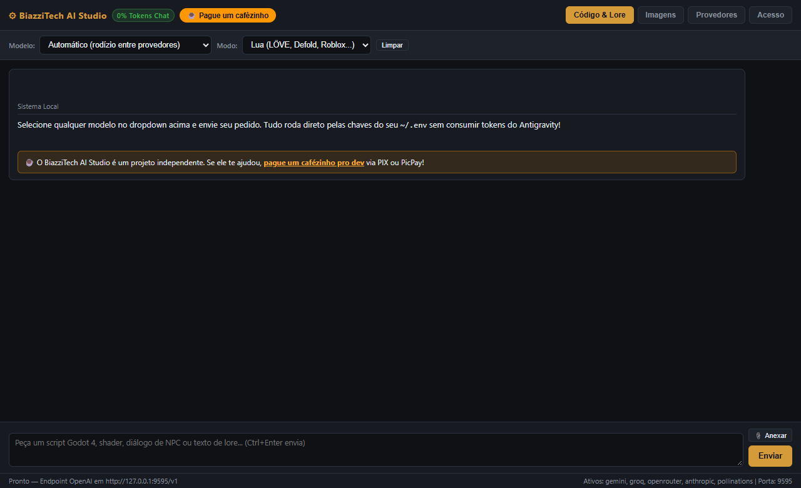
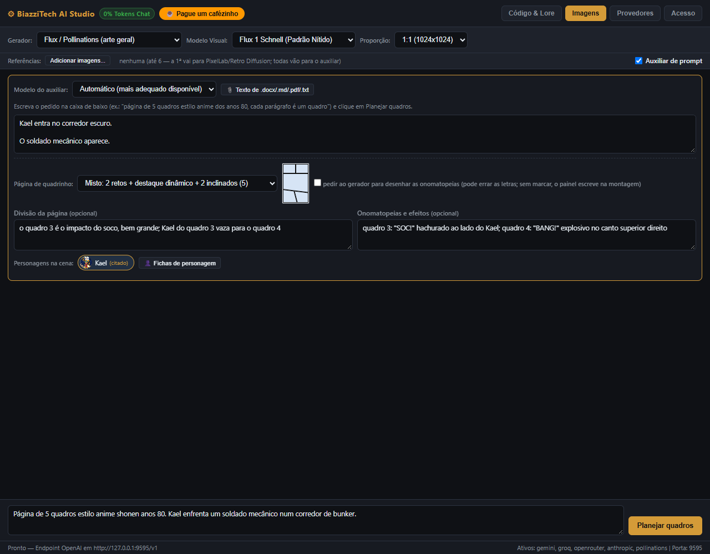
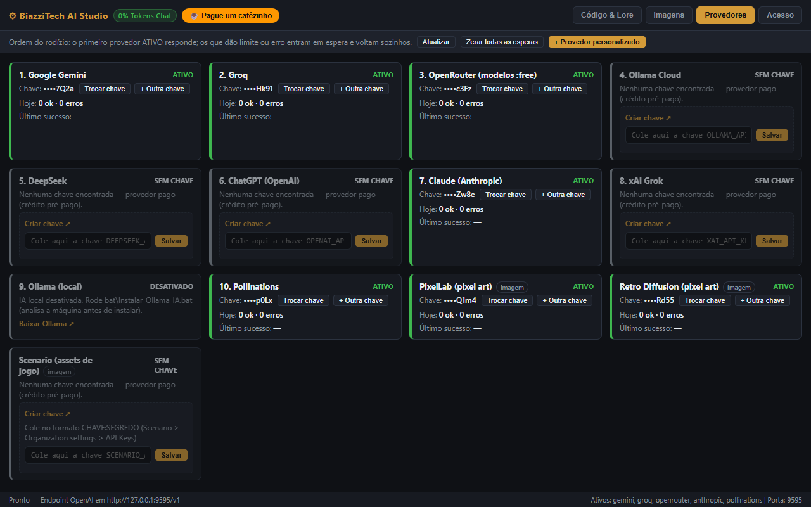
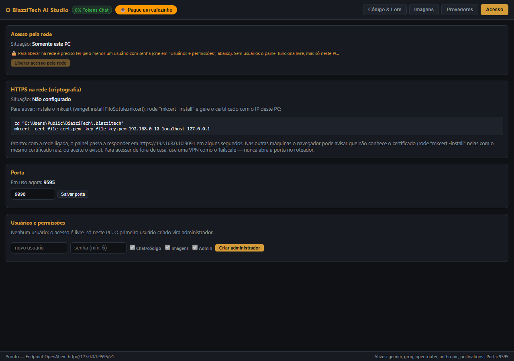
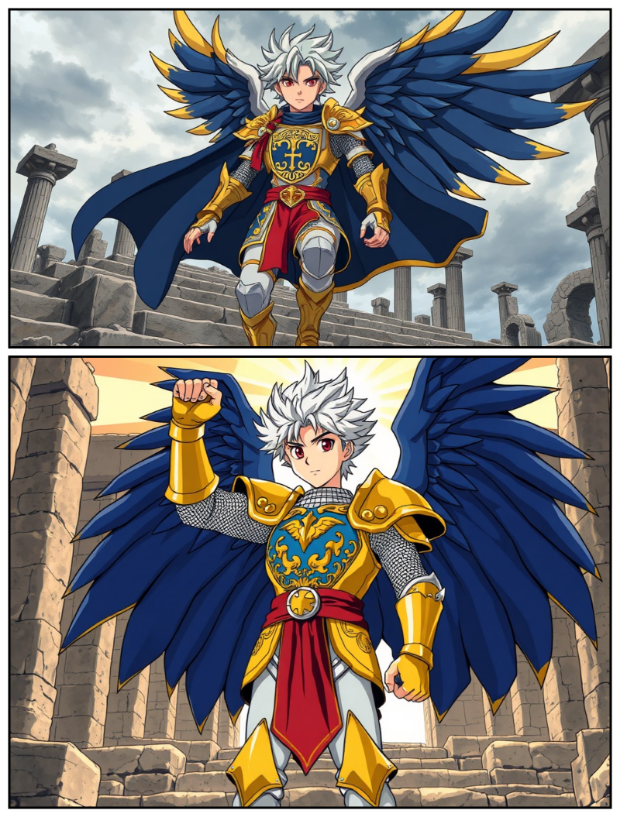
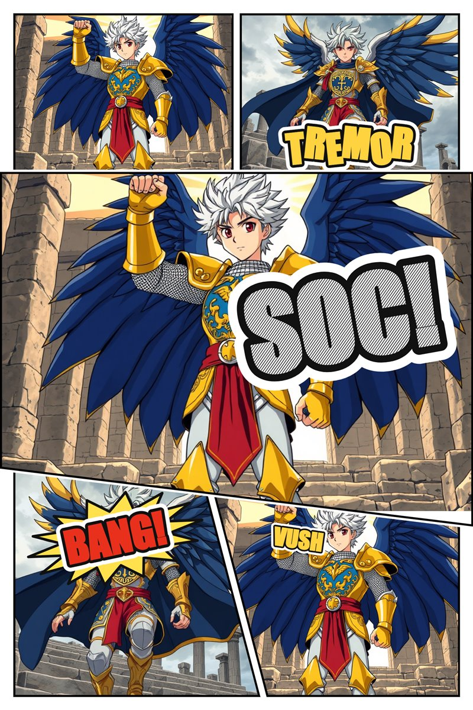
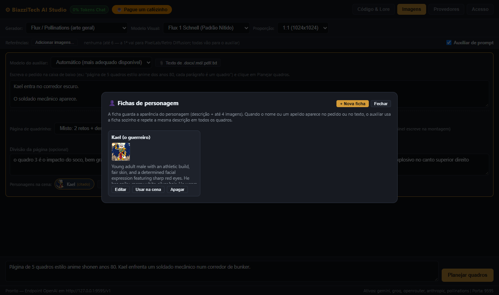
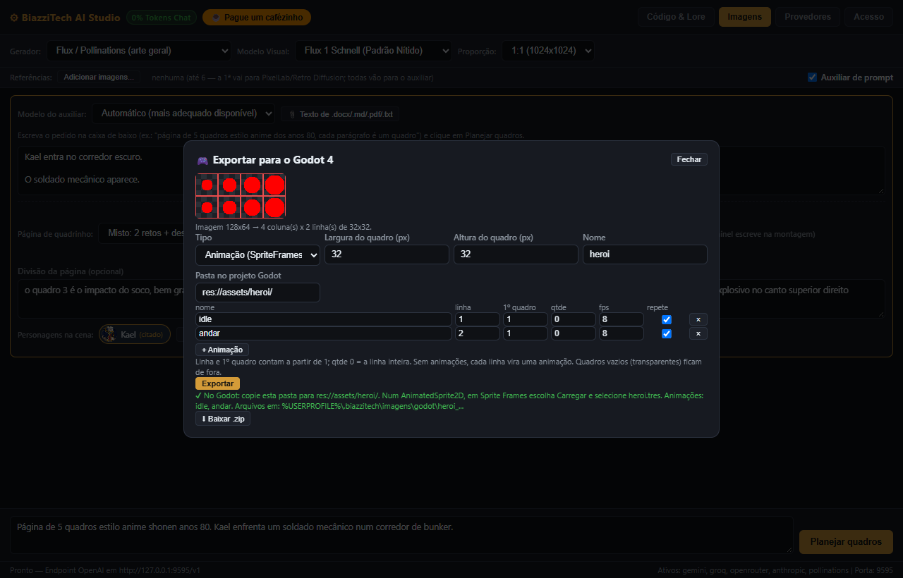
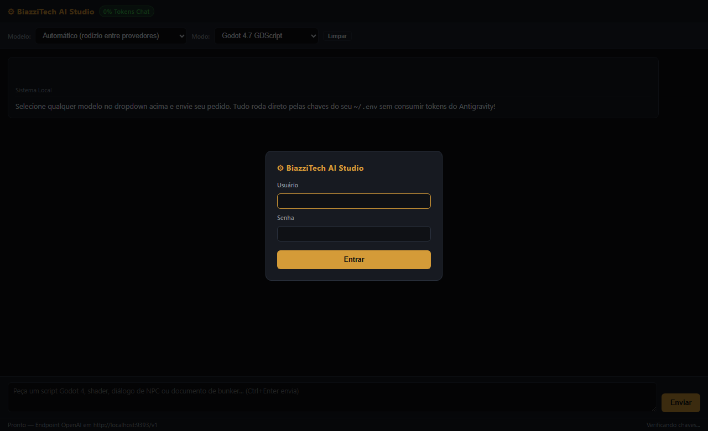

# ⚙ BiazziTech AI Studio

Estúdio de IA para quem cria jogos e histórias: código (Godot 4 / GDScript, Lua, Python, C#), lore, **páginas de quadrinho com personagens consistentes**, pixel art e **exportação direta para o Godot** — alternando sozinho entre vários provedores de IA, gratuitos primeiro.

- **Roda sozinho** (precisa só de Python, ou nem isso com o `.exe`) **ou dentro do Google Antigravity** como painel lateral (Sidecar) + servidor MCP.
- **Rodízio automático** entre Gemini, Groq, OpenRouter, Ollama Cloud, DeepSeek, ChatGPT, Claude, xAI, Ollama local e Pollinations: se um dá limite, falta de saldo ou erro, o próximo responde.
- **Quadrinhos**: fichas de personagem reutilizáveis, 20 modelos de página (e os seus, desenhados no Paint) (grades, dinâmicos com cortes inclinados, mistos), divisão da página descrita em texto, personagem que "vaza" do quadro e **onomatopeias** (hachurado, explosão, tremido) letreiradas na montagem.
- **Imagens**: Flux/Pollinations e **pixel art para jogos** (PixelLab, Retro Diffusion, Scenario), com imagem de referência e animação.
- **Godot 4**: spritesheet vira `SpriteFrames` com animações nomeadas; tileset vira `TileSet` pronto — é só copiar a pasta para o projeto.
- **Imagens offline com LoRAs**: Stable Diffusion local leve (SD 1.5, ~1.9 GB, roda até em placa integrada) e, se a máquina aguentar, o SDXL.
- **Conversas guardadas com memória**: cada conversa fica no servidor e volta ao recarregar; quando cresce, a IA resume o que importa e as mensagens antigas saem do contexto. O começo da conversa fica guardado para resgatar se a IA "perder o fio", e dá para fixar mensagens.
- **Proxy compatível com OpenAI** para Continue, Cline e outras ferramentas.
- **Usuários, senhas e acesso pela rede** (com HTTPS opcional); **porta configurável**.
- Só usa a biblioteca padrão do Python (sem `pip`); testes automáticos a cada envio.



> ### Novidades da 1.3.0
> - **🌐 Busca na internet com fontes** (Groq com busca embutida; Gemini com busca do Google de reserva) e **📍 lugares perto** pelo OpenStreetMap, com a localização do navegador — sem chave e sem IA.
> - **Modo demo**: sem nenhuma chave, as imagens já funcionam e o painel ensina a criar uma chave grátis para o chat.
> - **App instalável (PWA)** e layout para celular; **Android pelo Termux**, com o servidor rodando no próprio celular.
> - **Linux**: pacote **`.deb`** (menu de aplicativos e comando `biazzitech-studio`), testado num Ubuntu a cada versão.
>
> ### Novidades da 1.2.0
> - **Conversas guardadas no servidor**, por usuário, com 🧠 **memória** (compactar, editar, limpar), **contexto inicial** resgatado quando você reclama de perda de contexto, **redefinição** quando você diz que o contexto mudou (com **desfazer**) e 📌 **mensagens fixadas**. Opcional: a IA confirma a intenção e tira só o que conflita (gasta consulta extra; o chat pergunta antes).
> - **Usuários**: cada um vê só as próprias conversas e imagens; administradores veem as de todos.
> - **Auxiliar de imagens**: botão **✨ Gerar prompt** (uma imagem ou um prompt por quadro), modelos de página **P&B feitos no Paint**, e referências que funcionam mesmo sem modelo que enxerga imagens.
> - **Listas de modelos e geradores** mostram só o que tem chave funcionando e está ativo.
> - **⏹ Cancelar** pedidos, **Reiniciar servidor** pelo painel (administrador), galeria que continua lá ao recarregar.
> - **Assistente Livre** é o modo padrão do chat.
> - **Modo demo**: instalado sem nenhuma chave, o painel já gera imagens (Flux/Pollinations sem chave) e mostra o passo a passo para criar uma chave grátis para o chat.

> ### ☕ Pague um cafézinho pro dev!
> O BiazziTech AI Studio é um projeto independente, feito com dedicação e sem anúncios. Se ele te ajudou, apoie a evolução com qualquer valor:
>
> | | |
> |---|---|
> | **PIX** (chave e-mail) | `fausto@biazzitech.com.br` — Favorecido: BiazziTech / Fausto Sousa |
> | **PicPay** | [@faustobiazzi](https://picpay.me/faustobiazzi) |
>
> [](#-pague-um-cafézinho-pro-dev) [](https://picpay.me/faustobiazzi)
>
> No painel, o botão **☕ Pague um cafézinho** (no topo) mostra as mesmas opções com botões de copiar.

---

## Sumário

1. [Instalação](#1-instalação)
2. [Como abrir](#2-como-abrir)
3. [O painel](#3-o-painel)
4. [Rodízio de provedores e chaves](#4-rodízio-de-provedores-e-chaves)
5. [Claude e ChatGPT](#5-claude-e-chatgpt)
6. [Imagens e pixel art](#6-imagens-e-pixel-art) — [quadrinhos](#páginas-de-quadrinho-modelos-divisão-e-onomatopeias) · [fichas de personagem](#fichas-de-personagem) · [Godot](#exportar-para-o-godot-4)
7. [IA local (Ollama)](#7-ia-local-ollama) — [imagens offline com LoRAs](#imagens-offline-com-loras-stable-diffusion-local)
8. [Usuários, senhas, rede e porta](#8-usuários-senhas-rede-e-porta)
9. [Celular (app instalável e Android)](#9-celular-app-instalável-e-android)
10. [Versão .exe (sem Python)](#10-versão-exe-sem-python)
11. [Continue, Cline e outras ferramentas (proxy OpenAI)](#11-continue-cline-e-outras-ferramentas-proxy-openai)
12. [Pastas e arquivos](#12-pastas-e-arquivos)
13. [Segurança](#13-segurança)
14. [Problemas comuns](#14-problemas-comuns)
15. [Licença](#15-licença)
16. [Como o projeto é feito](#16-como-o-projeto-é-feito)

---

## 1. Instalação

**Pré-requisitos:** Windows 10/11, **Python 3.8+** (`python --version`) e Git. O Google Antigravity é **opcional**.

```powershell
git clone https://github.com/faustobiazzi/biazzitech-ai-studio.git
cd biazzitech-ai-studio
powershell -ExecutionPolicy Bypass -File .\instalar_motores.ps1
```

(ou dê duplo-clique em `bat\Instalar_Motores_IA.bat`)

O instalador faz 6 passos e pergunta o que precisar:

| Passo | O que faz |
|---|---|
| 1. Chaves | Grava as chaves em `%USERPROFILE%\.env`. Se faltar chave de um provedor **gratuito** (Gemini, Groq, OpenRouter), oferece abrir o site para criar e colar ali mesmo. |
| 2. App | Instala em `%USERPROFILE%\.biazzitech\app`. |
| 3. Porta, usuários e rede | Pergunta a **porta** (padrão 9090; recusa 8080 e portas ocupadas), oferece criar um **usuário administrador** e — só se houver usuário — explica os riscos e pergunta se libera o **acesso pela rede**. |
| 4. Antigravity | Só se o Antigravity estiver instalado: cria o painel lateral (Sidecar) e registra o servidor MCP `biazzitech`, sem apagar outros MCPs (instalações antigas com o MCP `deepseek` são migradas sozinhas). |
| 5. Atalhos | Atalho **BiazziTech AI Studio** na Área de Trabalho e, se quiser, iniciar com o Windows. |
| 6. IA local | **Analisa a capacidade da máquina** para modelos locais (recomendado / mínimo / abaixo do mínimo) e pergunta se instala o Ollama. |

**Opções úteis:**

```powershell
.\instalar_motores.ps1 -Modo standalone              # nunca mexe no Antigravity
.\instalar_motores.ps1 -Porta 9191 -AcessoRede sim   # outra porta, liberado na rede local
.\instalar_motores.ps1 -IniciarComWindows            # servidor sobe junto com o Windows
.\instalar_motores.ps1 -Ollama nao -SemPerguntas     # automatizado, sem perguntas
.\instalar_motores.ps1 -GroqKey "gsk_..." -GeminiKey "AIza..." -OpenAIKey "sk-..." -ClaudeKey "sk-ant-..."
```

Outras chaves aceitas: `-DeepSeekKey`, `-PollinationsKey`, `-OpenRouterKey`, `-XaiKey`, `-OllamaCloudKey`, `-PixelLabKey`, `-RetroDiffusionKey`, `-ScenarioKey` (formato `CHAVE:SEGREDO`), `-PixAIKey`.

### Linux (Debian, Ubuntu, Mint, Pop!_OS...)

Baixe o `biazzitech-ai-studio_<versão>_all.deb` na página de [Releases](https://github.com/faustobiazzi/biazzitech-ai-studio/releases) e instale:

```bash
sudo apt install ./biazzitech-ai-studio_*_all.deb
```

Abra pelo **menu de aplicativos → BiazziTech AI Studio** ou no terminal com `biazzitech-studio` (opções `--port 9191` e `--no-browser`). As chaves ficam em `~/.env` e os dados em `~/.biazzitech`, por usuário. Para remover: `sudo apt remove biazzitech-ai-studio` (seus dados ficam). Em outras distribuições, rode direto do repositório: `python3 biazzitech_studio.py`. O pacote é gerado por `python build_deb.py` (funciona em qualquer sistema) e é instalado e testado num Ubuntu a cada envio.

No Linux funciona o painel inteiro; o que é só do Windows: o instalador PowerShell, os `.bat`, o `.exe` e o "Abrir no visualizador". O Ollama do Linux é usado se estiver rodando; o SD local precisa do `sd-server` colocado à mão em `~/.biazzitech/sdlocal/bin`.

### Modo demo (sem nenhuma chave)

Dá para abrir o painel sem cadastrar chave nenhuma — nada fica ligado à conta de ninguém:

- **Imagens funcionam na hora**: o Flux/Pollinations gera sem chave (com marca d'água, limite menor e só os modelos Flux e Turbo). Uma chave grátis do Pollinations tira a marca.
- **Chat, auxiliar de prompt e memória** precisam de pelo menos uma chave de texto. O painel mostra uma faixa **🎮 Modo demo** com links para criar uma chave **grátis** (Google Gemini, Groq ou OpenRouter — uns 2 minutos, sem cartão) e um botão para colar na aba **Provedores**. A faixa some sozinha quando a chave funciona.
- **Sem internet ou sem conta:** IA no próprio PC com o Ollama (texto) e o Stable Diffusion local (imagens), se a máquina aguentar.

Por que não vem uma chave pronta? Toda chave pertence a uma conta; uma chave publicada num repositório é achada por robôs em horas e acaba gasta ou cancelada.

---

## 2. Como abrir

| Jeito | Como |
|---|---|
| **Atalho** (stand-alone) | Duplo-clique em **BiazziTech AI Studio** na Área de Trabalho. Sobe o servidor numa janela minimizada (feche-a para desligar) e abre o navegador. Se já estiver rodando, só abre o painel. |
| **Dentro do Antigravity** | Reinicie o Antigravity → *Skills & Customizations* → *Plugins* → **BiazziTech AI Studio** → em *Sidecars*, **Enable**. Depois, no painel da direita, botão **+** → BiazziTech AI Studio. |
| **Navegador** | `http://localhost:9090` (ou a porta escolhida) com o servidor rodando. |
| **Linha de comando** | `python %USERPROFILE%\.biazzitech\app\biazzitech_studio.py [--port 9191] [--no-browser]` |
| **.bat do repositório** | `bat\Abrir_Painel_Studio_IA.bat`, `bat\Iniciar_Proxy_IA.bat`, `bat\Gerar_GDScript_IA.bat`, `bat\Gerar_Texto_Lore_IA.bat`, `bat\Gerar_Imagem_IA.bat` |

---

## 3. O painel

### Código & Lore
Escolha o **Modelo** (ou *Automático* = rodízio) e o **Modo** (Assistente Livre — o padrão —, Godot 4.7 GDScript, Lua, Python, C#, Lore & Diálogos). Cada resposta mostra qual provedor/modelo respondeu. As listas mostram só os modelos com chave funcionando e ativos (os que estão em espera curta aparecem marcados). **⏹ Cancelar** interrompe o pedido em andamento.

**🌐 Busca na internet e lugares perto** (seletor *Web*: automático, sempre buscar ou desligada):
- No automático, o **Assistente Livre** manda para a busca as perguntas de fatos atuais — *"cotação do dólar hoje"*, *"quem ganhou o jogo ontem"*, *"horário de funcionamento do..."* — e responde resumido, **com as fontes** (links). Quem pesquisa é a Groq (GPT-OSS com busca embutida) e, de reserva, o Gemini com a busca do Google; usa as chaves que você já tem. Se nenhum buscador responder, a IA de conversa responde normalmente. Os modos de código e lore só buscam com *sempre buscar*.
- **"Onde tem uma padaria aqui perto?"** — lista os lugares mais próximos (nome, distância, endereço, horário quando o mapa tem, links de mapa e rota) pelo **OpenStreetMap**, sem chave e sem IA. Usa a **localização do navegador** (ele pede permissão; a posição vai só para a busca no mapa e não fica guardada) ou o lugar que você escrever: *"farmácia perto de Barão Geraldo, Campinas"*.
- **A localização só funciona com HTTPS** (ou no próprio PC, em `localhost`): pela rede em `http://IP:porta` o navegador bloqueia, e a barra de status avisa para habilitar o HTTPS ([seção 8](#8-usuários-senhas-rede-e-porta)). Sem ela, escreva o bairro e a cidade.
- Com as opções **🤖 Com ajuda da IA** ligadas, perguntas sem sinal claro ("quem é o presidente da Nintendo?") passam por uma IA que decide se vale buscar (1 consulta extra).

**Conversas:** cada conversa fica guardada no servidor e volta quando você recarrega a página ou entra de outro aparelho. O seletor **Conversa** lista as suas (com data), **+ Nova** começa outra, **Limpar** apaga as mensagens e a memória, 🗑 apaga a conversa.

**🧠 Memória** (botão ao lado do seletor):
- **Memória** — quando a conversa cresce, a IA resume em segundo plano o que importa (objetivo, decisões, nomes, pendências) e as mensagens antigas saem do contexto (continuam guardadas para reler). Dá para editar à mão ou **Compactar agora**.
- **📌 Contexto inicial** — as primeiras perguntas (3 a 10, enquanto forem do mesmo assunto) ficam guardadas à parte. Não vão em toda resposta: quando você reclama de perda de contexto (*"você esqueceu"*, *"como eu disse no início"*, *"saiu do assunto"*), elas voltam junto com os trechos antigos da conversa sobre o assunto.
- **Redefinir** — se você disser que o contexto mudou (*"o contexto mudou: agora é..."*, *"isso não vale mais"*), a sua mensagem vira o **contexto vigente** (vai em toda resposta), a IA procura na conversa o que se liga a ele e a memória é reescrita sem o que ficou obsoleto. Aparece um aviso com o que saiu e o botão **↩ Desfazer** (para quando era, por exemplo, a fala de um personagem).
- **📌 Fixar** — qualquer mensagem pode ser fixada (botão 📌 nela) e vai junto em toda resposta, mesmo depois de compactar.
- **🤖 Com ajuda da IA** (opcional, cada uso gasta **1 consulta extra**): confirmar com a IA se a frase era mesmo reclamação/mudança de contexto, e na mudança tirar **só o que conflita** em vez de trocar tudo. Na primeira vez que fizer sentido o chat pergunta se você quer ativar — responda *sim*, *faça*, *do it*, *manda bala*... ou *não*; depois dá para mudar nas caixas de marcar da 🧠 Memória.

A conversa do chat não muda nada no proxy `/v1` (Continue, Cline, MCP do Antigravity): ali quem manda o histórico continua sendo a ferramenta.

**📎 Anexar:** `.docx`, `.md`, `.txt` e `.pdf` entram como material de referência do pedido (até 60 mil caracteres por arquivo). PDF usa a biblioteca `pypdf`: o instalador oferece instalar (ou `pip install pypdf`) e o `.exe` já vem com ela.

As IAs **só devolvem texto — nada é executado na sua máquina**. Quando a resposta tem blocos de código, aparece **"Arquivos na resposta"** com nome sugerido (`.gd`, `.gdshader`, `.py`...), editável, e botões **Baixar** e **Copiar**.

### Imagens


Escolha o **Gerador** (Flux/Pollinations, PixelLab, Retro Diffusion, Scenario, Stable Diffusion local ou de outro PC — só aparecem os que estão ativos), o modo/estilo, o tamanho e, se quiser, uma **imagem de referência**. A galeria continua lá quando você recarrega a página: cada imagem tem um `.json` ao lado, com prompt, gerador e configurações. Cada imagem da galeria tem **Abrir**, **Compartilhar**, **Usar como referência**, **Animar**, **Reutilizar prompt**, **Corrigir**, **🎮 Godot** e **Excluir**. Detalhes na [seção 6](#6-imagens-e-pixel-art).

### Provedores


Um cartão por provedor, na ordem do rodízio: **ATIVO**, **EM ESPERA** (com o motivo e quando volta) ou **SEM CHAVE**; pedidos de hoje, limites informados pelo provedor e último erro. Sem chave? **Criar chave ↗** abre o site certo e o campo ao lado salva a chave (ela é testada antes). Também: **Trocar chave**, **+ Outra chave**, **Tentar de novo agora**.

### Acesso


Liga/desliga o **acesso pela rede**, mostra se o **HTTPS** está ativo (e como ativar), muda a **porta** e gerencia **usuários e permissões**. Só para administradores. Detalhes na [seção 8](#8-usuários-senhas-rede-e-porta).

---

## 4. Rodízio de provedores e chaves

O painel, o proxy, o MCP e os `.bat` usam o `provider_router.py`, que tenta os provedores **nesta ordem** e pula os que não podem responder:

| # | Provedor | Chave no `~/.env` | Plano |
|---|---|---|---|
| 1 | Google Gemini | `GEMINI_API_KEY` | grátis (com limites) |
| 2 | Groq | `GROQ_API_KEY` | grátis (com limites) |
| 3 | OpenRouter | `OPENROUTER_API_KEY` | usa só modelos `:free` |
| 4 | Ollama Cloud | `OLLAMA_API_KEY` | pago (créditos/assinatura) |
| 5 | DeepSeek | `DEEPSEEK_API_KEY` | pago (pré-pago) |
| 6 | ChatGPT (OpenAI) | `OPENAI_API_KEY` | pago |
| 7 | Claude (Anthropic) | `CLAUDE_API_KEY` | pago |
| 8 | xAI Grok | `XAI_API_KEY` | pago |
| 9 | Ollama (local) | `OLLAMA_ENABLED=1`, `OLLAMA_MODEL` | grátis, no seu PC |
| 10 | Pollinations | `POLLINATIONS_API_KEY` | rede de segurança |

**Como decide:**
- **429 (limite)** → espera o tempo que o provedor informar (ou até o reset diário); **402 (sem saldo)** e **401/403 (chave recusada)** → 6 h; **erro de rede/5xx** → 30 s. Volta sozinho.
- Na OpenRouter, se um modelo grátis estiver congestionado, tenta o próximo `:free` antes de pausar o provedor.
- Pedir um modelo específico (`deepseek-reasoner`, `groq/llama-3.3-70b-versatile`, `claude/auto`...) põe o provedor dele em primeiro; os outros ficam de reserva.
- O modelo de cada provedor é escolhido automaticamente (lista renovada a cada 24 h). Para fixar: `GROQ_MODEL=openai/gpt-oss-120b`, `OPENAI_MODEL=...`, `ANTHROPIC_MODEL=...`.
- Mudar a ordem: `ROUTER_ORDER=groq,gemini,openrouter,pollinations`. Limite local por dia: `GEMINI_DAILY_LIMIT=250`.

**Várias chaves do mesmo provedor:** botão **+ Outra chave** (ou `GROQ_API_KEY_2` ... `_9`). Cada uma vira um cartão ("Groq #2") e vai para o **fim do rodízio**: só é usada depois que **todos os outros provedores** falharem. Exceção: se você pedir um modelo daquele serviço (`groq/...`, `groq:...`), a principal e as extras dele vêm primeiro. Entre uma chave e outra do mesmo provedor há uma pausa de `ROUTER_KEY_DELAY` segundos (padrão **5**).

> ⚠ Ter mais de uma chave é normal em alguns casos (conta pessoal e do trabalho, projetos separados), mas **criar várias contas no mesmo serviço só para somar limites grátis costuma violar os termos de uso** e pode levar ao bloqueio de todas as contas. O painel avisa antes; a responsabilidade é de quem usa.

**Terminal:** `python provider_router.py status` · `python provider_router.py teste` · `python provider_router.py reset`

**Editar ou remover qualquer provedor** (inclusive os padrão): o botão **✎** no cartão muda o **nome exibido**, fixa um **modelo** (vazio = automático), **liga/desliga** o provedor no rodízio e **remove**. Remover apaga a chave do `~/.env` e esconde o cartão; **Mostrar removidos** traz de volta. Nas chaves extras ("Groq #2"), remover apaga só aquela chave. Os ajustes ficam em `%USERPROFILE%\.biazzitech\providers_override.json`.

### Provedores personalizados (texto, imagens ou os dois)

Na aba **Provedores**, botão **+ Provedor personalizado** (só administradores). O campo **Usar para** escolhe em qual lista ele aparece:

- **Texto** — qualquer servidor compatível com a OpenAI; entra no rodízio do chat e no auxiliar.
- **Imagens** — um **Stable Diffusion de outro PC** (de um amigo, do PC da sala...) com a API WebUI ligada: [stable-diffusion.cpp](https://github.com/leejet/stable-diffusion.cpp) (`sd-server --listen-ip 0.0.0.0`, de preferência com `--api-key`), **AUTOMATIC1111 / Forge / SD.Next** (iniciados com `--api --listen`, e `--api-auth usuario:senha` se quiser senha). Aparece na aba **Imagens** como ★ Nome, com **os modelos e as LoRAs daquele PC**, modo rápido (se ele tiver a LoRA LCM), imagem de referência e as LoRAs das fichas de personagem. Chave: a `--api-key` do sd-server, ou `usuario:senha` do `--api-auth`.
- **Os dois** — servidor que faz texto e imagens.

Exemplos de texto:

- **Ollama de outro PC da rede** — `http://IP-DO-PC:11434/v1` (no outro PC, deixe o Ollama aceitar conexões da rede com a variável `OLLAMA_HOST=0.0.0.0`).
- **LM Studio** — `http://localhost:1234/v1`.
- **vLLM / SGLang / llama.cpp server** na nuvem ou num servidor próprio — inclusive modelos abertos grandes (ex.: versões abertas do Grok), que não cabem num PC comum.

Campos: **nome**, **URL** (pode digitar só `host:porta`; o painel completa com `/v1`), **chave** (opcional), **modelo** (*Testar conexão* lista os modelos do servidor), **posição no rodízio** (antes de todos, depois dos gratuitos, antes do Ollama local/Pollinations ou no fim), **enxerga imagens** (para o auxiliar de prompt usar com referências) e **é pago**.

- Aparece como cartão no painel, entra no rodízio na posição escolhida e nos menus de modelo do chat e do auxiliar (★ Nome). No proxy: `<id>/auto` (ex.: `custom_ollama_da_sala/auto`).
- Se o servidor estiver desligado, o cartão mostra *servidor não responde* e o rodízio pula para o próximo.
- Ficam em `%USERPROFILE%\.biazzitech\custom_providers.json`; a chave (se houver) vai para o `~/.env`.

---

## 5. Claude e ChatGPT

- **ChatGPT:** `OPENAI_API_KEY` (platform.openai.com/api-keys). No painel: *ChatGPT*; no proxy: `chatgpt/auto` ou um nome `gpt-...`.
- **Claude:** `CLAUDE_API_KEY` (platform.claude.com/settings/keys) — de propósito **não** é `ANTHROPIC_API_KEY`, para não interferir em outras ferramentas. Padrão: **Claude Opus 5.5** (`claude-opus-5-5`); para gastar menos, `ANTHROPIC_MODEL=claude-sonnet-5-5` ou `claude-haiku-5-5`. O roteador fala com a API Messages nativa, não envia `temperature` (recusado pela versão atual da API) e liga o *fallback* automático do servidor quando um pedido é recusado pelos filtros de segurança.
- Os dois são pagos e entram no rodízio depois dos gratuitos e da DeepSeek.

---

## 6. Imagens e pixel art

| Gerador | Chave | Modos | Referência |
|---|---|---|---|
| **Flux / Pollinations** | `POLLINATIONS_API_KEY` | Flux Schnell, Flux Pro, Flux Flex, Animagine, Z-Image Turbo | — |
| **PixelLab** | `PIXELLAB_API_KEY` | Sprite/imagem, personagem 4 ou 8 direções, tileset top-down (prompt `chão \| topo`), animar | ✔ |
| **Retro Diffusion** | `RETRODIFFUSION_API_KEY` | Estilos (geral, plataforma, top-down, isométrico...), tiles, animações prontas (andar 4 direções, batalha, VFX, rotação 8 dir.), animar referência | ✔ |
| **Scenario** | `SCENARIO_API_KEY` = `CHAVE:SEGREDO` | Qualquer modelo pelo `modelId` | ainda não |

- **Referências (até 6):** *Adicionar imagens...* ou *Usar como referência* numa imagem da galeria. A 1ª vai para PixelLab/Retro Diffusion/Stable Diffusion; todas vão para o auxiliar de prompt. O **Flux/Pollinations não recebe imagem**: ao gerar nele com referência, o painel oferece que o auxiliar olhe a imagem e reescreva o prompt descrevendo o personagem.
- **Animar:** botão *Animar* em qualquer imagem (PixelLab, 8 quadros). Animações da Retro Diffusion voltam como **spritesheet PNG**.
- Personagens em várias direções e tilesets voltam como várias imagens (uma por direção/tile).
- Tudo é salvo em `%USERPROFILE%\.biazzitech\imagens`.
- **Reutilizar prompt:** volta o prompt e as configurações daquela imagem para a caixa de geração.
- **Corrigir:** diga o que saiu errado ("mãos deformadas", "o cabelo devia ser preto", "apareceu texto"). O auxiliar olha a imagem, reescreve o prompt com reforços e exclusões adequados ao erro, explica o que mudou e oferece gerar de novo.

### Auxiliar de prompt (quadrinhos, storyboards, sequências)



1. Marque **Auxiliar de prompt** na aba Imagens.
2. Cole o **texto de referência** (ou *📎 Texto de .docx/.md/.pdf/.txt*) e adicione as **imagens dos personagens**.
3. Escreva o pedido, por exemplo: *"página de 5 quadros estilo anime shonen dos anos 80 com os personagens das imagens; cada parágrafo é um quadro"*, e clique em **Planejar quadros** — ou em **✨ Gerar prompt**: com página de vários quadros ele escreve um prompt por quadro; com um quadro só (ou sem página), escreve **um prompt de tela inteira** e coloca direto na caixa para você gerar.
4. O auxiliar descreve o estilo e cada personagem a partir das imagens e monta **um prompt completo por quadro**, repetindo a descrição dos personagens em todos (é o que mantém a consistência, já que o gerador não tem memória). Cada quadro mostra o trecho do texto, o enquadramento, a proporção e o que evitar — tudo editável.
5. **Gerar este** / **Gerar todos os quadros** usam o gerador escolhido lá em cima; **Montar página** junta os quadros numa página com bordas (salva na galeria).

Se o modelo escolhido falhar ou devolver uma resposta quebrada, o auxiliar tenta sozinho o próximo (até 3). Pedidos com imagens vão primeiro para provedores que enxergam imagens; se nenhum responder (sem chave, em espera ou sem cota), o prompt é escrito por um modelo de texto e o painel **avisa que as imagens não foram vistas**.

### Páginas de quadrinho: modelos, divisão e onomatopeias



Com o auxiliar ligado aparecem três campos extras (veja o print da aba Imagens, na seção 3):

- **Página de quadrinho** — *Sem página* (quadros soltos), *Automático* (o auxiliar escolhe o modelo pelo número de quadros e pela ação), um dos **20 modelos** prontos — grades iguais (2x2, 2x3), faixas, colunas, destaques, clássicos de 5 e 6 quadros, **dinâmicos** com cortes inclinados para a direita, para a esquerda ou em zigue-zague (2 a 6 quadros), **mistos** (quadros dinâmicos grandes junto com quadros retos) e página inteira — ou **+ Modelo P&B** para importar o seu próprio desenho feito no Paint (linhas pretas fechadas no fundo branco, ou blocos pretos). Uma miniatura mostra o desenho da página e cada quadro já é pedido na proporção do espaço dele.
- **Divisão da página** — texto livre: *"quadros dinâmicos com cortes em diagonal acompanhando a ação"*, *"o personagem do quadro 4 vaza para o quadro 3"*, *"quadro 1 bem largo como abertura"*. O auxiliar reforça o movimento nos prompts e marca **vaza do quadro** onde for o caso: na montagem esse quadro fica por cima dos vizinhos, com moldura branca.
- **Onomatopeias e efeitos** — *"quadro 2: 'SOC!' hachurado ao lado do personagem; quadro 4: 'BANG!' explosivo no canto de cima à direita"*. Cada quadro do plano ganha a lista de efeitos (texto, estilo **hachurado / explosão / tremido / simples**, posição e tamanho), editável. Por padrão o **painel escreve as onomatopeias na montagem** (letras sempre certas) e pede ao gerador para deixar o espaço livre; marcando *"pedir ao gerador para desenhar"*, elas entram no prompt (fica mais integrado ao desenho, mas os geradores costumam errar letras).

<br clear="right">

### Fichas de personagem



Botão **👤 Fichas de personagem** (no auxiliar). Cada ficha guarda **nome, apelidos, aparência** (em inglês, do jeito que vai no prompt), notas e **até 4 imagens**.

- **✨ Descrever pelas imagens** escreve a aparência a partir das fotos (com um modelo que enxerga imagens); revise e salve.
- **💾 Salvar como ficha** aparece nos personagens de um plano que ainda não têm ficha.
- Quando o **nome ou um apelido aparece no pedido ou no texto de referência** (sem ligar para acento ou maiúsculas), a ficha entra sozinha — o chip do personagem mostra *(citado)*. Também dá para marcar à mão quem está na cena.
- O auxiliar repete a aparência da ficha **palavra por palavra** em todos os quadros em que o personagem aparece e envia as imagens dela como referência. É isso que mantém o personagem igual de uma página para a outra.
- Ficam em `%USERPROFILE%\.biazzitech\personagens.json` (imagens em `personagens\`).

### Exportar para o Godot 4



Botão **🎮 Godot** em qualquer PNG da galeria (spritesheets da Retro Diffusion/PixelLab, tilesets, folhas feitas por você):

- **Animação (SpriteFrames):** informe o tamanho do quadro e as animações (nome, linha, primeiro quadro, quantidade, fps, repete). Sem animações, cada linha da folha vira uma. Quadros vazios (transparentes) ficam de fora.
- **Tileset (TileSet):** tamanho do tile, margem e espaçamento; um tile é criado para cada célula com algum pixel visível.
- A grade aparece por cima da imagem para conferir. Informe a **pasta no projeto Godot** (ex.: `res://assets/heroi/`): os `.tres` já apontam para ela.
- Saída em `%USERPROFILE%\.biazzitech\imagens\godot\<nome>_<data>\` (PNG + `.tres` + LEIA-ME) e um **.zip para baixar**. No Godot: copie a pasta para o caminho escolhido e carregue o `.tres` no *AnimatedSprite2D* (Sprite Frames) ou no *TileMapLayer* (Tile Set).

**Modelo do auxiliar:** *Automático* escolhe o mais adequado disponível — com imagens, um modelo que enxerga imagens (Gemini, Claude, ChatGPT ou um `:free` com visão na OpenRouter); só com texto, Claude/ChatGPT/Gemini/GPT-OSS. Também dá para escolher um modelo fixo. Quando um estilo é citado pelo nome de uma obra, o auxiliar descreve as características visuais dele no prompt.

- PixelLab, Retro Diffusion e Scenario são pagos (créditos). As APIs mudam com frequência: se algum modo der erro de formato, ajuste em `image_providers.py`.

---

## 7. IA local (Ollama)

Roda um modelo **no seu PC**: grátis, sem limite e sem internet. O passo 6 do instalador (ou `bat\Instalar_Ollama_IA.bat`) **analisa a máquina antes**:

| Resultado | Critério | O que acontece |
|---|---|---|
| Recomendado | RAM ≥ 16 GB e GPU NVIDIA/AMD ≥ 6 GB | instala |
| Mínimo | RAM ≥ 8 GB, ≥ 4 núcleos, ≥ 10 GB livres, Windows 10 22H2+ 64 bits | instala, avisando que pode ficar lento |
| Abaixo do mínimo | algum item acima não atendido | **NÃO RECOMENDADO** — mostra o motivo e avisa que o desempenho pode ser muito prejudicado; você decide (padrão: não) |

- O modelo é escolhido pelo hardware (`qwen2.5-coder` 14b/7b/3b/1.5b); escolha outro com `-Modelo "gemma4:26b-a4b-it-qat"` ou troque depois com `ollama pull <modelo>` + `OLLAMA_MODEL=<modelo>` no `~/.env`.
- Opções: `-SomenteVerificar`, `-Instalar sim|nao`, `-Forcar`.
- No painel, modelo **Ollama local** (`ollama/auto`) usa só ele. Modelos locais são bem mais fracos que Claude/Gemini para código complexo; servem para tarefas pequenas, tradução e uso offline.

### Imagens offline com LoRAs (Stable Diffusion local)

O "Ollama das imagens": gera **no seu PC, sem internet e sem créditos**, e aceita **LoRAs** (estilos e personagens treinados). Feito para **máquinas simples**: o motor é o [stable-diffusion.cpp](https://github.com/leejet/stable-diffusion.cpp), um executável pequeno sem Python/PyTorch que usa **qualquer placa de vídeo** (NVIDIA, AMD ou Intel, inclusive integrada, via Vulkan) ou só o processador.

`bat\Instalar_SD_Local_IA.bat` (ou o passo 6 do instalador principal) **analisa a máquina** e oferece:

| Versão | O que baixa | Para quem |
|---|---|---|
| **Leve** | SD 1.5 quantizado (GGUF Q8) + LoRA LCM — **~1.9 GB** | 8 GB de RAM bastam; com placa de vídeo sai em segundos, só com processador leva 1–3 min |
| **Pesada** (opcional) | SDXL + VAE corrigido + LoRA LCM SDXL + LoRA de pixel art — **~7.8 GB** | só é oferecida se sobrar recurso: placa de 8 GB, ou 4 GB + 24 GB de RAM (mais lenta) |

- O motor vai para `%USERPROFILE%\.biazzitech\sdlocal` (motor, `models\checkpoints`, `models\loras`, `models\vae`). Downloads interrompidos continuam de onde pararam.
- Se o motor de placa de vídeo (Vulkan) não funcionar, o instalador troca sozinho para o de processador.
- No painel: **Gerador → Stable Diffusion local**. Escolha o modelo (leve/pesado), a proporção e **rápido (LCM)** — 6 passos em vez de ~22, o que deixa tudo várias vezes mais rápido. O motor liga sozinho na primeira imagem e libera a memória depois de 10 minutos parado.
- **LoRAs:** botão **LoRAs (n)** lista as instaladas, com peso. Para adicionar, baixe o `.safetensors` (ex.: civitai.com, huggingface.co) do **mesmo tipo do modelo** (SD 1.5 ou SDXL) e coloque em `models\loras`. Muitas pedem uma palavra de ativação no prompt.
- **Imagem de referência:** a 1ª referência vira "imagem para imagem"; **força da ref.** controla quanto a nova pode mudar.
- **Fichas de personagem:** campos **LoRA do personagem**, peso e **palavra de ativação**. Quando o personagem está na cena (citado ou marcado), a LoRA e a palavra entram sozinhas — inclusive em cada quadro das páginas de quadrinho. O botão **📦 Pacote para treinar LoRA** baixa as imagens da ficha com legendas no formato dos treinadores (Civitai, kohya_ss, OneTrainer).
- Licenças: SD 1.5 e SDXL usam licenças abertas OpenRAIL (uso livre, inclusive comercial, com restrições de uso nocivo); o instalador mostra o aviso antes de baixar.
- **Já testado de verdade:** versão leve com placa NVIDIA de 4 GB via Vulkan (modo rápido ~30 s por imagem 512px, qualidade ~2 min, imagem de referência). **Experimental** (feito, coberto por testes automáticos, mas ainda sem teste em máquina real): motor só de processador, versão pesada (SDXL) e servidores AUTOMATIC1111/Forge de outro PC. Se der problema, abra uma issue com o arquivo `sdlocal\sd-server.log`.
- Opções do instalador: `-SomenteVerificar`, `-Instalar sim|nao`, `-Versao leve|pesado|ambas`, `-Backend vulkan|cpu`, `-Forcar`. No `~/.env`: `SDLOCAL_ENABLED`, `SDLOCAL_MODEL`, `SDLOCAL_PORT` (padrão 7861), `SDLOCAL_ARGS`, `SDLOCAL_ARGS_SDXL`, `SDLOCAL_URL` (usar um `sd-server` que já roda em outro PC).

---

## 8. Usuários, senhas, rede e porta



**Sem nenhum usuário cadastrado o acesso é livre, mas só neste PC.** A rede exige pelo menos um usuário com senha. Para controlar quem usa:

- Crie o primeiro usuário na instalação ou na aba **Acesso** — ele vira **administrador** automaticamente.
- Permissões simples: **Chat/código**, **Imagens**, **Admin** (chaves, usuários, rede, porta).
- Cada usuário recebe um **token** (`btk_...`) para usar no Continue/Cline no lugar da chave de API.
- Senhas guardadas com hash + salt (PBKDF2-SHA256), nunca em texto. 5 senhas erradas bloqueiam o IP por 5 minutos.
- Quem usa **o próprio PC do servidor** entra direto; marque *"Exigir login também neste PC"* para mudar isso.
- **Cada usuário vê só as próprias conversas e imagens.** Administradores veem as de todos: na galeria aparece o dono de cada imagem (com o filtro *só as minhas*) e no chat a opção **de todos** lista as conversas dos outros (só leitura). As conversas feitas no próprio PC sem login contam como do administrador, que pode continuá-las logado pela rede. Imagens antigas, sem dono registrado, aparecem só para administradores.
- **Reiniciar servidor** (aba Acesso, só administrador) aplica a troca de porta na hora.

**Acesso pela rede** (aba Acesso ou `-AcessoRede sim` na instalação):
- Só liga com **usuário cadastrado** e depois de você **confirmar que leu os riscos** (a data fica registrada). Liga/desliga **na hora**, sem reiniciar; apagar o último usuário fecha a rede sozinho.
- As outras máquinas acessam o endereço que o painel mostra. Se o Windows perguntar sobre o firewall, permita em **Redes privadas**.
- Os logins (certos, errados e bloqueados) ficam em `%USERPROFILE%\.biazzitech\acessos.log` — sem senhas.

**HTTPS na rede (recomendado):** sem HTTPS, senha e conversas trafegam sem criptografia na rede. Para ativar:

```powershell
winget install FiloSottile.mkcert
mkcert -install
cd $env:USERPROFILE\.biazzitech
mkcert -cert-file cert.pem -key-file key.pem 192.168.0.10 localhost 127.0.0.1   # troque pelo IP deste PC
```

Com `cert.pem` e `key.pem` nessa pasta e a rede ligada, o painel passa a atender a rede em **`https://<IP>:<porta+1>`** (ex.: 9091) em poucos segundos, e a porta normal fica só neste PC. Nas outras máquinas o navegador pode avisar que não conhece o certificado: rode `mkcert -install` nelas com o mesmo certificado raiz (`mkcert -CAROOT` mostra onde está) ou aceite o aviso.

**Fora de casa:** use uma VPN como o **Tailscale** (rede privada criptografada entre seus aparelhos). **Nunca** abra a porta do painel no roteador para a internet.

**Porta:** escolhida na instalação ou na aba Acesso (vale ao clicar em **Reiniciar servidor** ou no próximo início). A 8080 e portas ocupadas são recusadas. Fica em `%USERPROFILE%\.biazzitech\config.json`.

**Terminal:** `python access_control.py show` · `set port 9191` · `set lan true` (exige usuário) · `add-user NOME --perms chat,imagens` · `del-user NOME`

---

## 9. Celular (app instalável e Android)

**App instalável (PWA):** o painel pode virar um app com ícone na tela inicial e tela cheia — no celular ou no PC. Abra o painel no navegador e use o botão **📲 Instalar app** (ou o menu do navegador → *Instalar app* / *Adicionar à tela inicial*). O navegador só oferece isso em **HTTPS** ou em `localhost`; pela rede em `http://IP:porta`, ative o HTTPS ([seção 8](#8-usuários-senhas-rede-e-porta)). O app guarda só a "casca" do painel para abrir rápido; conversas, imagens e chaves continuam no servidor.

**Android sem PC (Termux):** o servidor roda no próprio celular, porque só usa a biblioteca padrão do Python.

1. Instale o **Termux** pelo F-Droid ou pelo GitHub do Termux (a versão da Play Store está desatualizada).
2. No Termux:
   ```bash
   pkg install -y curl && curl -fsSL https://raw.githubusercontent.com/faustobiazzi/biazzitech-ai-studio/main/termux/instalar_termux.sh | bash
   ```
3. Para abrir: `studio` — o navegador abre em `http://localhost:9090` (como é `localhost`, a **localização funciona** para "lugares perto"). Depois, **📲 Instalar app** põe o ícone na tela inicial.

Funciona no celular: chat com rodízio, conversas e memória, busca na web, lugares perto, imagens online (Pollinations, PixelLab, Retro Diffusion, SD de outro PC), quadrinhos e fichas. Não funciona: SD local, Ollama e a integração com o Antigravity. Deixe o Termux aberto enquanto usa (o atalho `studio` pede ao Android para não pausar o servidor).

## 10. Versão .exe (sem Python)

1. Numa máquina **com** Python, rode `bat\Gerar_EXE.bat`. Na primeira vez ele pede para instalar o **PyInstaller**.
2. Saída: `dist\BiazziTech AI Studio.exe` (um arquivo, ~9 MB). Copie para qualquer Windows 10/11 e dê duplo-clique.
3. Cadastre as chaves pela aba **Provedores** (ficam em `%USERPROFILE%\.env` daquele PC). Sem chave nenhuma ele abre em [modo demo](#modo-demo-sem-nenhuma-chave): imagens já funcionam.

O `.exe` tem o painel, o rodízio, as imagens e o controle de acesso. A integração com o Antigravity e o Ollama ficam com o instalador em PowerShell. Alguns antivírus estranham `.exe` do PyInstaller; se bloquear, libere o arquivo.

---

## 11. Continue, Cline e outras ferramentas (proxy OpenAI)

| Campo | Valor |
|---|---|
| Base URL | `http://localhost:9090/v1` (ou a porta/IP configurados) |
| API Key | `local` — ou o **token `btk_...`** do usuário, se houver usuários cadastrados e o acesso for pela rede |
| Modelos | `auto`, `gemini-flash-latest`, `groq/openai/gpt-oss-120b`, `openrouter/auto-free`, `claude/auto`, `chatgpt/auto`, `ollama/auto`, `deepseek-chat`, `deepseek-reasoner`, `openai/gpt-5.3-codex`, `<provedor personalizado>/auto`... |

Streaming (SSE) funciona. A resposta traz o campo `provider` com quem respondeu.

---

## 12. Pastas e arquivos

| O que | Onde |
|---|---|
| Chaves | `%USERPROFILE%\.env` |
| App instalado | `%USERPROFILE%\.biazzitech\app` |
| Imagens geradas (cada uma com um `.json` de metadados e dono) | `%USERPROFILE%\.biazzitech\imagens` |
| Conversas do chat (memória, contexto inicial, fixadas) | `%USERPROFILE%\.biazzitech\conversas\` |
| Porta / rede | `%USERPROFILE%\.biazzitech\config.json` |
| Usuários | `%USERPROFILE%\.biazzitech\users.json` |
| Provedores personalizados | `%USERPROFILE%\.biazzitech\custom_providers.json` |
| Estado do rodízio | `%USERPROFILE%\.biazzitech\router_state.json` |
| Fichas de personagem | `%USERPROFILE%\.biazzitech\personagens.json` e `personagens\` |
| Exportações para o Godot | `%USERPROFILE%\.biazzitech\imagens\godot\` |
| Stable Diffusion local (motor, modelos, LoRAs) | `%USERPROFILE%\.biazzitech\sdlocal\` |
| Registro de logins | `%USERPROFILE%\.biazzitech\acessos.log` |
| Certificado HTTPS (opcional) | `%USERPROFILE%\.biazzitech\cert.pem` e `key.pem` |
| Sidecar do Antigravity | `%USERPROFILE%\.gemini\config\plugins\biazzitech-ai-studio` |

**Repositório:**

| Arquivo | Função |
|---|---|
| `instalar_motores.ps1` | Instalador (porta, usuários, rede, Antigravity, atalhos, Ollama) |
| `instalar_ollama.ps1` | IA local com análise de hardware |
| `biazzitech_studio.py` | Lançador stand-alone |
| `studio_server.py` | Servidor do painel, API e proxy OpenAI |
| `studio_ui.html` + `ui/studio.css` + `ui/studio.js` | Painel (HTML, estilos e lógica) |
| `provider_router.py` | Rodízio de provedores e chaves |
| `image_providers.py` | PixelLab, Retro Diffusion, Scenario |
| `access_control.py` | Porta, rede, usuários e senhas |
| `prompt_assist.py` | Auxiliar de prompt (planejar quadros, gerar prompt, corrigir prompts, descrever personagens) |
| `conversations.py` | Conversas do chat: memória, compactação, contexto inicial, fixar e visibilidade por usuário |
| `web_search.py` | Busca na internet com fontes (Groq/Gemini) e lugares perto (OpenStreetMap) |
| `characters.py` | Fichas de personagem |
| `comic_layouts.py` | Modelos de página de quadrinho |
| `godot_export.py` | Exportação de spritesheets/tilesets para o Godot 4 |
| `sd_local.py` + `instalar_sd_local.ps1` | Stable Diffusion local (offline, LoRAs) e o instalador dele |
| `doc_extract.py` | Texto de anexos .docx/.md/.txt/.pdf |
| `studio_mcp.py` | Servidor MCP para o Antigravity (ferramentas `studio_code`, `studio_text`, imagens e status) |
| `studio_cli.py`, `free_image_gen.py`, `pixai_gen.py` | Ferramentas de linha de comando |
| `tests/` | Testes automáticos (sem internet e sem chaves) |
| `build_exe.ps1` | Gera o `.exe` |
| `build_deb.py` | Gera o pacote `.deb` para Linux |
| `plugin_antigravity/` | Plugin/Sidecar do Antigravity |
| `bat/` | Atalhos de duplo-clique |
| `termux/instalar_termux.sh` | Instalação no Android pelo Termux |
| `ui/manifest.webmanifest`, `ui/sw.js`, `ui/icon-*.png` | App instalável (PWA) |
| `docs/img/` | Prints deste README |

---

## 13. Segurança

- O servidor escuta **só neste PC** até você liberar a rede — e a rede exige usuário com senha.
- **Outros sites abertos no navegador não conseguem usar o painel** nem suas chaves: todo pedido de envio confere a origem, e o navegador só libera leitura das respostas para o próprio painel.
- Cookie de sessão `HttpOnly` + `SameSite=Strict` (e `Secure` com HTTPS); senhas com PBKDF2; bloqueio após 5 erros; registro de logins.
- Imagens, fichas e exportações só podem ser lidas/apagadas dentro das próprias pastas.
- As chaves nunca são mostradas inteiras no painel (só os 4 últimos caracteres).
- Achou uma falha? Veja o [SECURITY.md](SECURITY.md) para avisar em particular.

### Responsabilidade de uso

O BiazziTech AI Studio é uma ferramenta para uso local. Liberar o acesso pela rede é uma decisão de quem instala. Cada usuário é responsável pelas próprias chaves, pelo cumprimento dos termos de uso de cada provedor de IA (inclusive quanto ao uso de várias contas) e pelo conteúdo que gerar. O projeto não coleta dados nem envia nada ao autor. O software é fornecido sem garantias, conforme as seções 15 e 16 da licença.

---

## 14. Problemas comuns

| Sintoma | O que fazer |
|---|---|
| Painel sem a aba Provedores/Acesso ou com versão antiga | Rode o instalador de novo e recarregue a página (ou reinicie o Antigravity). |
| "Todos os provedores falharam" | Veja a aba Provedores: chaves faltando ou todos em espera. Cadastre uma chave grátis (Gemini/Groq/OpenRouter). |
| DeepSeek/Ollama Cloud em espera "sem saldo (402)" | A conta precisa de créditos; o rodízio segue com os outros. |
| Outra máquina não abre o painel | Confira se o acesso pela rede está ligado, o IP/porta certos e se o firewall do Windows permitiu o Python em redes privadas. |
| Porta ocupada | Escolha outra na aba Acesso ou rode o instalador com `-Porta 9191`. |
| Ollama lento | Normal em máquinas sem GPU dedicada; use modelos menores ou deixe o rodízio usar os provedores online. |

---

## 15. Licença

Copyright © 2026 BiazziTech (Fausto Sousa).

O BiazziTech AI Studio é software livre sob a **[GNU Affero General Public License v3.0](LICENSE)** (AGPL-3.0):

- Você pode usar, estudar, modificar e redistribuir, inclusive para fins comerciais.
- Se distribuir uma versão modificada **ou oferecê-la como serviço pela rede** (ex.: hospedar o painel para outras pessoas), precisa disponibilizar o código-fonte completo dessa versão sob a mesma licença.
- Sem garantias de qualquer tipo (veja o texto da licença).

**Licença comercial:** para usar o código em um produto fechado, sem as obrigações da AGPL, fale com o autor: `fausto@biazzitech.com.br`.

**Contribuições** são bem-vindas — leia o [CONTRIBUTING.md](CONTRIBUTING.md) antes de abrir um pull request.

---

## 16. Como o projeto é feito

O BiazziTech AI Studio é **desenvolvido com auxílio de IA** (Claude e Google Antigravity). A ideia, as decisões de produto, a revisão e a responsabilidade pelo projeto são do autor; as IAs ajudam a escrever e revisar o código.

**Testes:** `python -m unittest discover -s tests -t tests` — cobrem o rodízio, o controle de acesso, a segurança das rotas (inclusive HTTPS de verdade), anexos, auxiliar de prompt, quadrinhos, fichas e a exportação para o Godot. Rodam sem internet e sem chaves, e rodam sozinhos no GitHub a cada envio.
